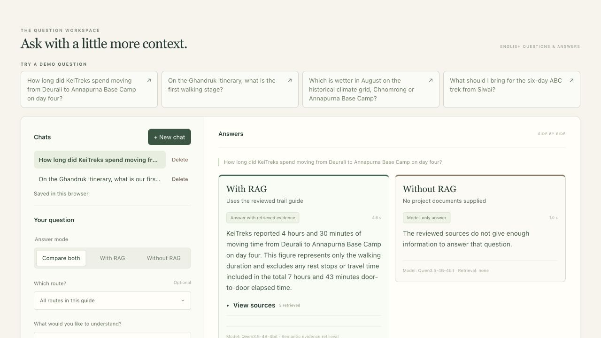

# Trailwise · Annapurna Base Camp trekking assistant

Trailwise is an English-language web app for hikers planning an Annapurna Base Camp (ABC) trek in Nepal. It compares five published approaches and answers questions about walking time, equipment, weather and preparation. A split-screen chat lets you ask the same question with and without retrieval-augmented generation (RAG), then inspect the evidence behind the guide’s reply.

[](https://colab.research.google.com/github/Chen-Xingjian/trailwise-abc/blob/main/notebooks/abc_rag_walkthrough.ipynb)

**Try the notebook in your browser.** Click the badge and choose **Runtime → Run all**. The default CPU runtime downloads the public data and installs the walkthrough dependencies. The data check should show **85 accepted facts, 20 source records and 85 chunks**. You can inspect a real retrieval result and its prompt, then inspect the frozen blind-test results and all three turns from the presentation. On a configured Mac, Run All also opens the same local chat as the shell launcher and requests a fresh pair of answers from its API.



## Try the conversation

1. **“What’s the weather forecast for Annapurna Base Camp tomorrow?”** Both columns can check the same dated forecast.
2. **“On the six-day trek from Siwai, how long did KeiTreks actually spend walking from Deurali to ABC?”** The trip log records **4 h 30 min moving** and **7 h 43 min including stops** on that uphill stage.
3. **“Given that forecast, what gear should I bring for that stretch?”** In the recorded demonstration, both versions asked for the date again. The guide also asked for the forecast point. Neither delivered a packing suggestion.

This example shows both the value of a documented observation and a failure to use that evidence across topics. [Read the three original turns](outputs/weather-stage-gear-first-answers.json).

## Run locally on an Apple Silicon Mac

The full app uses **Python 3.12**, a local MLX generation server and two pinned model downloads. From a terminal with Git and Python 3.12 installed:

```sh
git clone https://github.com/Chen-Xingjian/trailwise-abc.git
cd trailwise-abc
python3.12 scripts/setup_mac.py --install
source ~/Library/Caches/Trailwise/nepal-trail-rag/fresh-venv/bin/activate
python scripts/download_models.py
./run-abc-live.command
```

Open **[the local chat](http://127.0.0.1:8765/)** after startup. On later runs, use just the last command. The model service uses port 8081. Ctrl+C stops both services. Weights and indexes are stored in the Mac’s cache. Model downloads require internet access. Live forecasts, notices and source checks also need a connection. The public repository hosts the code and examples. The web app runs on your computer.

**Notebook entry on the same Mac.** After the one-time setup above, activate the same environment, install Jupyter once, and open the walkthrough from the repository folder.

```sh
source ~/Library/Caches/Trailwise/nepal-trail-rag/fresh-venv/bin/activate
python -m pip install jupyterlab ipykernel
python -m jupyterlab notebooks/abc_rag_walkthrough.ipynb
```

Choose **Run All**. The last cell calls the same launcher, opens the same [local chat](http://127.0.0.1:8765/), and requests a fresh RAG and baseline answer. You can use either entry first. A running instance is reused after its application fingerprint, release, semantic index and generation settings are checked. Colab’s hosted CPU runs the document and retrieval walkthrough and replays the presentation evidence. Live generation uses the configured Mac.

## What the guide knows

| Topic | Sources and scope |
| --- | --- |
| Route and schedule | Published schedules for Jhinu Danda, Siwai, Ghandruk, Nayapul/Birethanti and the Ghorepani–Poon Hill approach. Each schedule distinguishes walking, driving and mixed days. Detailed measurements come from KeiTreks’ single six-day Siwai reference. [Compare the daily stages](documents/ABC_ITINERARY_AUDIT.md). |
| Equipment and preparation | Selected National Park Service, Wikivoyage and CDC guidance, with the original qualifications attached. Hikers can discuss gear and past experience. Individual medical clearance is outside the app’s scope. |
| Season and current conditions | ERA5 summaries describe historical conditions near three points. DWD ICON through Open-Meteo supplies dated forecasts. Nepal Tourism Board and municipal notices can identify published updates. An empty notice search leaves trail access unresolved. |

Both entry points use the **presentation release with 85 facts from 20 source records**. The release ID is `ABC-KT06-LOCAL-TEST-20261122-R1`. Its five release files match the frozen coursework package byte for byte. G09 is the project’s own reminder to confirm booking terms. The original review is preserved with the publication context in [NOTICE.md](NOTICE.md). [Data guide](documents/README.md) · [Attribution and reuse terms](documents/abc-six-day/ATTRIBUTION.txt)

## How the comparison works

Both columns use the same local **Qwen3.5-4B** configuration for text generation. The guide represents reviewed passages with **Qwen3-Embedding-0.6B**, searches **Qdrant Local**, and supplies matching evidence to the model. For some stage measurements it can read a reviewed field directly. The baseline uses its own conversation history and the model’s knowledge. Both can use the same public weather and trail tools when enabled. **View sources** exposes the records or external lookup behind a reply. [Model revisions](config/model_pins.json) · [Runtime and source checks](docs/DEPLOYMENT.md)

## Evaluation and limitations

The frozen offline comparison used 12 single-topic questions and four two-turn scenarios. Both modes used the same model settings with live tools off. One grader scored the first replies with mode labels hidden. The final turn of each scenario contributed up to two points. Opening turns were scored separately.

| Frozen result on the coursework edition | With RAG | Without RAG |
| --- | ---: | ---: |
| Final turns, all 16 scenarios | 15/32 | 13/32 |
| Final turns, four combined scenarios | 2/8 | 3/8 |
| Scenarios won outright | 5 | 5 |

Six cases tied. The comparison measures the complete application modes, including structured lookups. It gives limited evidence about multi-turn reliability or other trekking areas. The weather demonstration above was a separate live run. These scores belong to the original 85-fact edition. [Questions](outputs/abc-control-blind-20261125/questions.json) · [First replies and retrieved IDs](outputs/abc-control-blind-20261125/first-answers.jsonl) · [Scores](outputs/abc-control-blind-20261125/results.json)

## Repository guide

| Path | Contents |
| --- | --- |
| [documents/](documents/) | Reviewed facts, source registry, scope, checksums and itinerary audit |
| [notebooks/](notebooks/) | Walkthrough from a source record to retrieval and answer comparison |
| [outputs/](outputs/) | Selected first replies, scores and demonstration evidence |
| [app/](app/) | FastAPI chat, browser interface, retrieval, model integration and live tools |
| [scripts/](scripts/) and [tests/](tests/) | Setup, release validation, ingestion and automated checks |
| [docs/](docs/) | Architecture, data cleaning, deployment and earlier review notes |

The documents, notebooks and outputs layout follows the [CP5403 assessment reference project](https://github.com/Georgegiri/cp5403-rag-assessment-helper).

## Verify the release

From the project environment with development dependencies installed:

```sh
python scripts/validate_release.py --release documents/abc-six-day
python -m pytest -q
node --test tests/*.test.mjs
```

The JavaScript tests require Node.js. The offline tests run without model weights. New facts go through source and licence review, release validation and re-indexing. [Cleaning and ingestion](docs/CLEANING_AND_INGESTION.md) · [Source, code and model notices](NOTICE.md)
